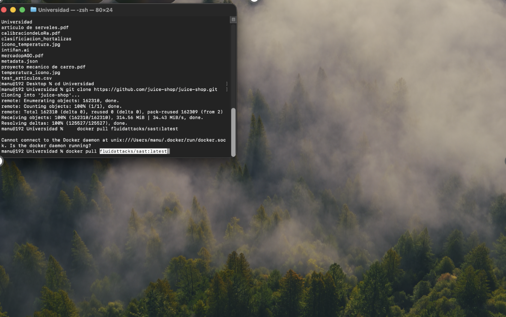
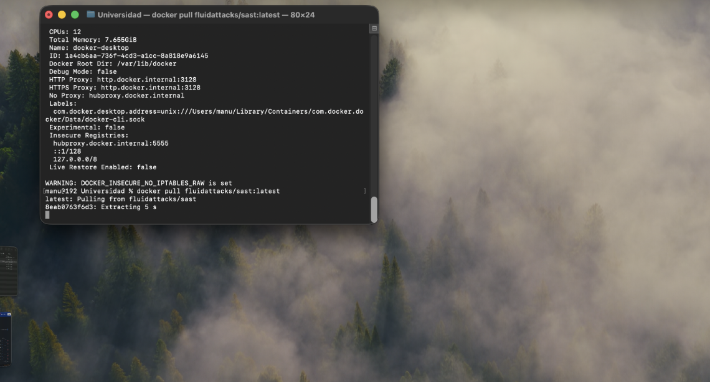
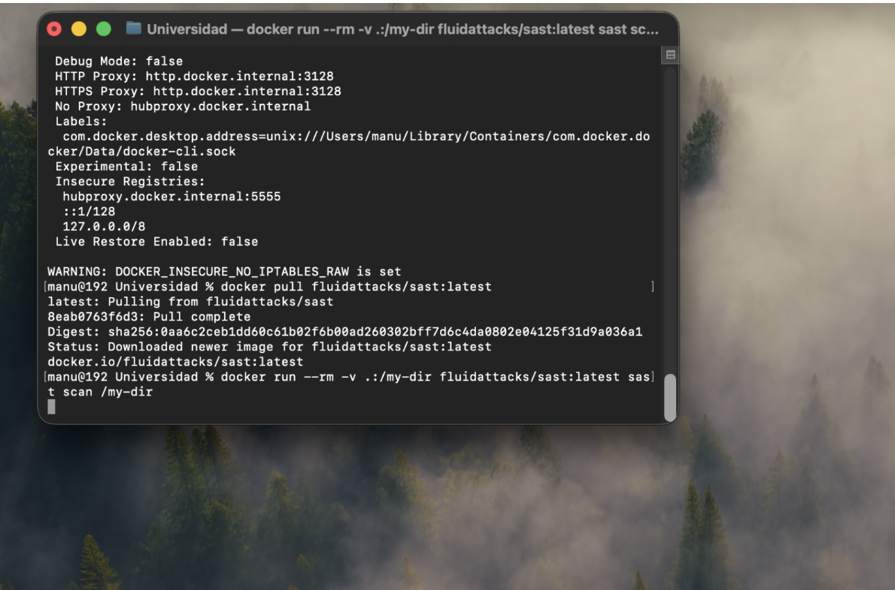
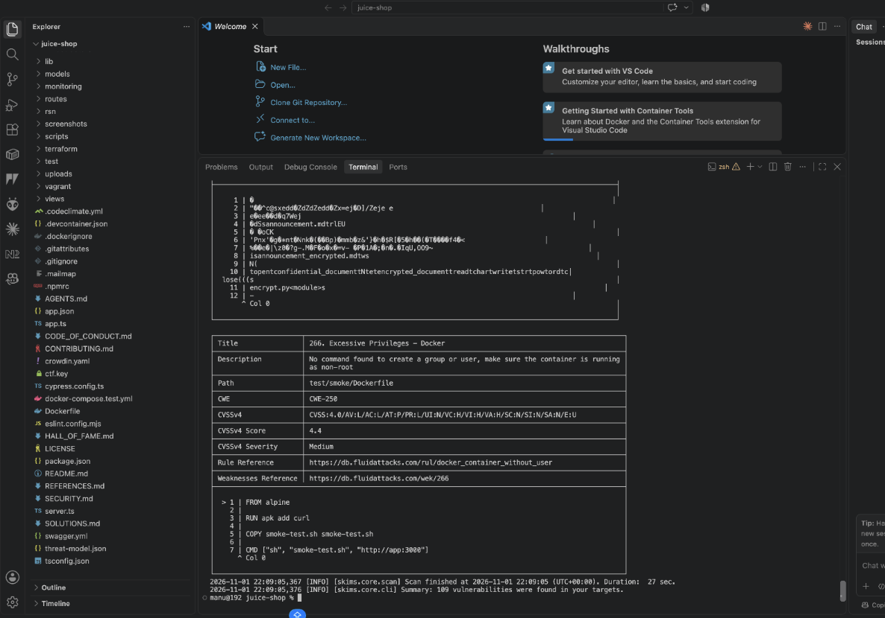
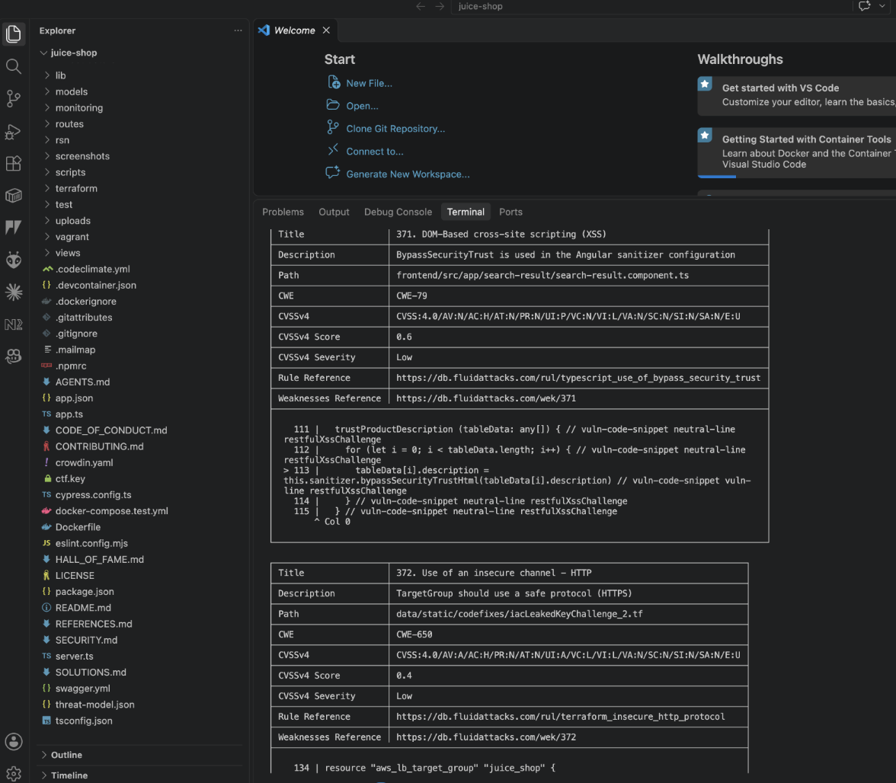
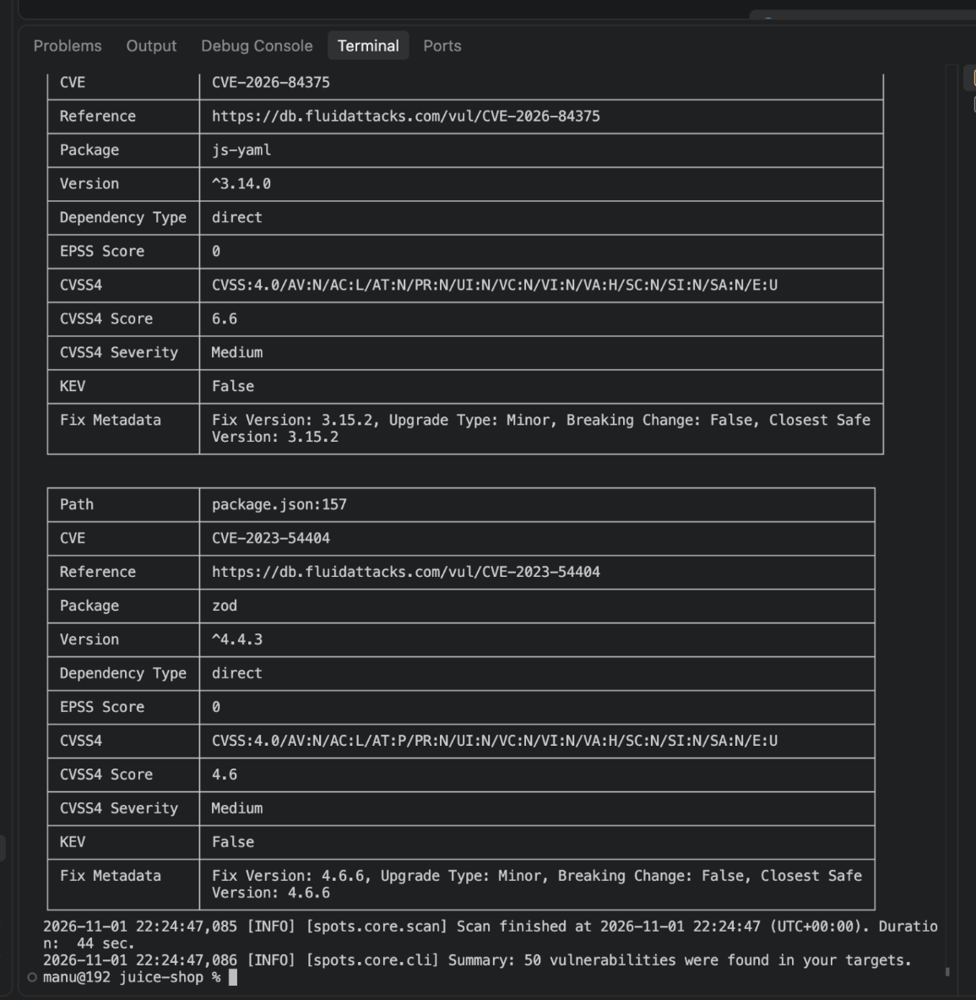
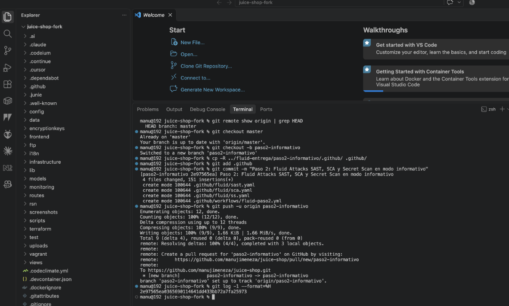
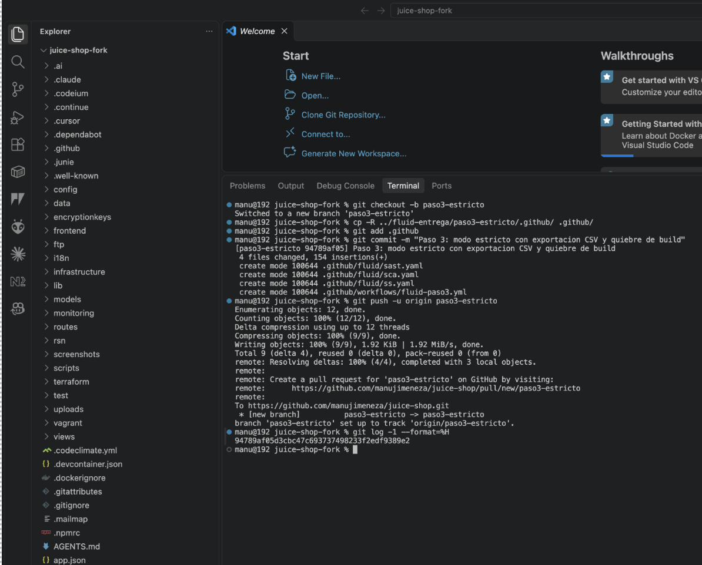
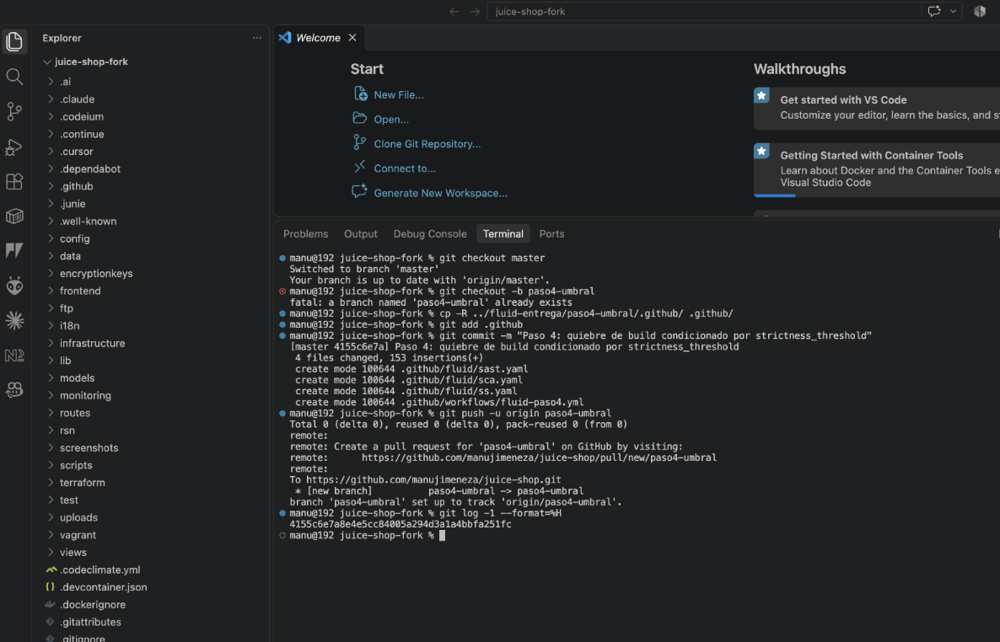
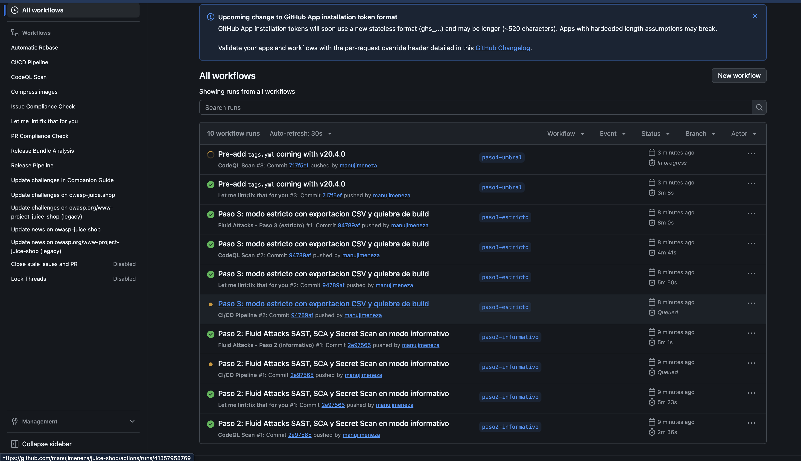

# Taller 4: Fluid Attacks con Juice Shop

Desarrollo de Sistemas Seguros
Manuela Jiménez Arredondo

Para este trabajo usé OWASP Juice Shop. Hice un fork en mi cuenta ([manujimeneza/juice-shop](https://github.com/manujimeneza/juice-shop)) y sobre ese fork configuré los escáneres de Fluid Attacks (SAST, SCA y Secret Scan), primero en local con Docker y después en GitHub Actions.

## Enlaces de los commits

- Paso 2: https://github.com/manujimeneza/juice-shop/commit/2e97565ea0365690114641dd433bb72a7fa25973
- Paso 3: https://github.com/manujimeneza/juice-shop/commit/a6eb166f7aca74f9618b837f1f23c34e3fab5224
- Paso 4: https://github.com/manujimeneza/juice-shop/commit/641acd04afaf9879a29bfc29e5a618a331bfcfe9

| Paso | Rama | Resultado en Actions |
|---|---|---|
| 2 | paso2-informativo | [Verde](https://github.com/manujimeneza/juice-shop/actions/runs/41357862214) |
| 3 | paso3-estricto | [Rojo en los tres jobs](https://github.com/manujimeneza/juice-shop/actions/runs/41359285248) |
| 4 | paso4-umbral | [Rojo solo en SCA](https://github.com/manujimeneza/juice-shop/actions/runs/41359304451) |

## Paso 1. Ejecución en local

Primero cloné el repositorio original de Juice Shop en mi computador y descargué la imagen de Docker del CLI.

```zsh
cd ~/Desktop/Universidad
git clone https://github.com/juice-shop/juice-shop.git
docker pull fluidattacks/sast:latest
```

La primera vez me salió el error `Cannot connect to the Docker daemon` porque no tenía Docker Desktop abierto. Lo abrí y volví a correr el comando.





Cuando terminó la descarga ejecuté el escaneo montando la carpeta actual en el contenedor:

```zsh
docker run --rm -v .:/my-dir fluidattacks/sast:latest sast scan /my-dir
```



El escaneo tardó 27 segundos y encontró 109 vulnerabilidades. En la terminal se ve mi usuario (`manu@192 juice-shop`), o sea que se está ejecutando en mi máquina y no en un servidor.



Uno de los hallazgos es un XSS basado en DOM en `search-result.component.ts`, porque usan `bypassSecurityTrustHtml` (CWE-79).



También probé el SCA, que revisa las dependencias del proyecto. Encontró 50 vulnerabilidades, por ejemplo en `js-yaml` y `zod`.

```zsh
docker pull fluidattacks/sca:latest
docker run --rm -v .:/my-dir fluidattacks/sca:latest sca scan /my-dir
```



Además lo corrí con un archivo de configuración para que me exportara los resultados en CSV:

```zsh
docker run --rm -v .:/my-dir fluidattacks/sast:latest sast scan /my-dir/config-local.yaml
```

El archivo de configuración y el CSV que salió están en [evidencias](evidencias/).

## Antes de los pasos 2, 3 y 4

Hice el fork de Juice Shop y activé GitHub Actions en el fork (viene desactivado por defecto). Después lo cloné en `juice-shop-fork`. La rama principal es `master`.

Creé una rama distinta para cada paso, todas a partir de `master`, así cada commit queda separado. En cada rama solo agregué archivos dentro de `.github`:

```
.github/
├── fluid/
│   ├── sast.yaml
│   ├── sca.yaml
│   └── ss.yaml
└── workflows/
    └── fluid-pasoN.yml
```

Algunas cosas que tuve que tener en cuenta en los workflows:

- Puse `fetch-depth: 0` en el checkout porque las actions necesitan el historial de git para saber cuál es la rama principal.
- Usé `scanner_mode: full`. Si no, en ramas que no son la principal el escáner solo revisa los archivos que cambiaron, y como yo solo agregué archivos en `.github` no habría escaneado nada.
- Los resultados los guardé como artefactos del workflow para poder descargarlos.

## Paso 2. Modo informativo

En este paso los tres escáneres solo reportan y no rompen el build. En los archivos de SAST y SCA dejé:

```yaml
strict: false
output:
  format: SARIF
```

El de Secret Scan es más sencillo porque esa action solo acepta las claves `ss` y `output`.



Los tres jobs salieron en verde, que era lo esperado.

## Paso 3. Modo estricto y exportación a CSV

Aquí había que exportar a CSV y hacer que el build falle. En SAST y SCA cambié a:

```yaml
strict: true
output:
  format: ALL
```

Con `ALL` se genera el CSV y el SARIF. En Secret Scan puse `format: CSV`, porque ahí no se puede usar `ALL`.



### Problema que encontré

La primera vez que lo subí (commit `94789af`) el workflow salió en verde, aunque tenía `strict: true`. Me pareció raro, así que revisé el código de la action ([generate-config.sh](https://github.com/fluidattacks/sast-action/blob/main/generate-config.sh)) y vi esto:

```bash
docker run ... sast scan "${CONFIG_FILE}" || exit_code=$?
if [[ ${exit_code} -eq 0 ]]; then
  echo "vulnerabilities_found=false" >> "${GITHUB_OUTPUT}"
elif [[ ${exit_code} -eq 1 ]]; then
  echo "vulnerabilities_found=true" >> "${GITHUB_OUTPUT}"
```

O sea, el escáner sí termina con error, pero la action lo atrapa y solo deja una variable `vulnerabilities_found=true`, sin hacer fallar el job. Para solucionarlo agregué un paso al final de cada job que revisa esa variable:

```yaml
- name: Romper el build (modo estricto)
  if: steps.scan.outputs.vulnerabilities_found == 'true'
  run: exit 1
```

En Secret Scan además cuento las filas del CSV, porque ese escáner termina bien aunque encuentre secretos.

También noté que con `format: ALL` el archivo se llamaba `fluid-sast-estricto.sarif.csv` y no `fluid-sast-estricto.csv`, por eso no se estaba guardando. Cambié la ruta a `fluid-sast-estricto*`.

Con eso (commit `a6eb166`) los tres jobs salieron en rojo. Eso es lo correcto, porque Juice Shop está hecho para ser vulnerable.

Los CSV que se generaron están en [evidencias/paso3](evidencias/paso3/).

## Paso 4. Umbral de severidad

En este paso el build solo debe fallar si hay vulnerabilidades graves. En SAST y SCA agregué:

```yaml
strict: true
strictness_threshold: high
output:
  format: ALL
```

Con `high` el escáner sigue reportando todo en el CSV, pero solo falla si encuentra algo high o critical. En el workflow dejé el mismo paso de corrección que en el paso 3.

Secret Scan no tiene `strictness_threshold` (según la documentación solo lo tienen SAST, SCA y DAST), así que en este paso lo dejé informativo. Lo expliqué en un comentario en `ss.yaml`.



En la captura se ve que `git checkout -b paso4-umbral` me dio error porque la rama ya existía, y el commit quedó en `master`. Lo corregí moviendo el commit a la rama `paso4-umbral` y dejando `master` como estaba.

Resultado:

| Job | Resultado | Por qué |
|---|---|---|
| SAST | Verde | No hay hallazgos high o critical (igual quedan todos en el CSV) |
| SCA | Rojo | Hay dependencias con vulnerabilidades high o critical |
| Secret Scan | Verde | Es informativo |

Me parece interesante que con el mismo código SAST falla en el paso 3 y pasa en el paso 4; ahí se nota el efecto del umbral.

Los CSV están en [evidencias/paso4](evidencias/paso4/).

## Ejecuciones en GitHub Actions



Esta captura la tomé antes de corregir el paso 3, por eso todavía aparece en verde. Los resultados finales están en los enlaces del principio.

## Conclusiones

- En local y en GitHub Actions el escáner encuentra lo mismo. La ventaja del pipeline es que se ejecuta solo cada vez que se sube código.
- Tiene sentido ir por etapas: primero modo informativo para ver cómo está el proyecto, después estricto, y al final con un umbral para bloquear solo lo grave y no detener el desarrollo por hallazgos menores.
- Aprendí que no basta con poner `strict: true` y ver el pipeline en verde. Hay que comprobar que de verdad bloquea, porque en mi caso la action no estaba haciendo fallar el build.
